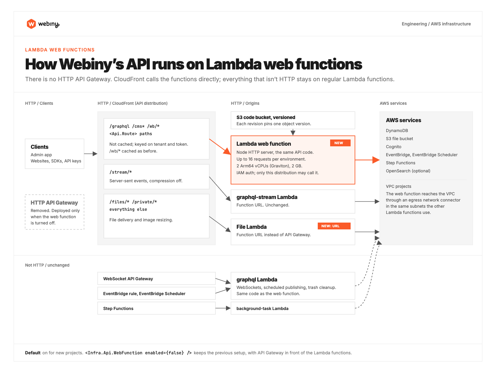

In October, AWS released [Lambda web functions](https://docs.aws.amazon.com/lambda/latest/dg/web-functions.html), a new kind of Lambda that runs your code as an ordinary Node HTTP server. We spent last week moving Webiny's API onto them, and the short version is that the API got a lot faster. GraphQL requests answer 20 to 42% faster at the median, and in our tests the multi-second waits under load are gone.

The change is in review now and will most likely ship in Webiny 6.6. This post is about what changes, the numbers we measured, and what it means for a project you already have.

## How the API runs today

Every request to a Webiny API on AWS takes the same path. CloudFront receives it, hands it to API Gateway, and API Gateway invokes the `graphql` Lambda function.

That setup has served us well for years, and it has two costs. API Gateway is one more hop on every request. It's a good service if you need what it adds, like throttling, usage plans or request validation, but Webiny's API used none of that. API Gateway only passed requests on to the Lambda. And a regular Lambda function handles one request at a time. When ten requests arrive at once and only three copies of the function are warm, Lambda starts seven new copies, and each of those requests waits for its copy to boot. For Webiny's API that boot took about 1.3 seconds in our tests, before the request itself even started.

Here's one request on that path, and the same request on a web function:


## What a web function changes

A web function is a Node HTTP server that Lambda runs and scales for you. One running copy, which AWS calls an environment, serves many requests at the same time, the way any web server does. We let each environment take up to 16 at once.

Here's the whole API with a web function, including the parts that don't change:



CloudFront calls the web function directly, and there's no API Gateway in between. `/graphql`, the Headless CMS APIs, the Website Builder routes and any custom routes you've added with `<Api.Route>` all go there. File requests lose API Gateway too. CloudFront now calls the file Lambda through its own Function URL, and the Lambda itself is unchanged.

Some things don't change. Web functions only answer HTTP requests. So background tasks, scheduled publishing, the WebSocket API and the nightly trash cleanup still run on the regular `graphql` Lambda, exactly as before. It's the same code, so nothing behaves differently. They just don't receive HTTP traffic anymore.

## Why this needed 6.6

Before 6.6 we couldn't have done this at all. The backend didn't have the architecture for it. Since the summer we've been building 6.6 in parallel with 6.5, and a big part of that work went into how the backend code is structured. That restructuring is what lets the same API code run on a web function, so for us the switch was mostly an infrastructure change and not a rewrite of the API. It's also the work behind [standalone Webiny](https://www.webiny.com/blog/webiny-is-no-longer-aws-only-introducing-standalone-webiny), which runs the API as a plain Node process.

## The numbers

We deployed the same project with both setups in eu-central-1 and called both from the same machine in the same run. Each operation got 50 requests after 5 warm-up requests.


| Median per request | API Gateway + Lambda | Web function |
|---|---|---|
| `{ __typename }` | 63 ms | 40 ms |
| List roles | 63 ms | 42 ms |
| List teams | 63 ms | 43 ms |
| Get a CMS entry | 67 ms | 43 ms |
| Create a CMS entry | 125 ms | 73 ms |
| Update a CMS entry | 138 ms | 83 ms |

In this run reads were 33 to 36% faster and writes 40 to 42%. A second run on another day gave smaller gains, 20 to 27% for reads and 33 to 41% for writes. Network conditions differ from run to run, and it's worth saying so. The direction was the same in both.

The bigger difference shows up when requests arrive together. We sent 20 requests at once, three times:

| 20 requests at once, slowest 10% | API Gateway + Lambda | Web function |
|---|---|---|
| List roles | 2,286 ms | 184 ms |
| Update a CMS entry | 1,757 ms | 288 ms |

That's the cold start problem from earlier. With the regular Lambda, a burst of requests means a burst of new copies, and the requests at the back of the line each wait more than a second for theirs. Web function environments take many requests each, so a burst mostly lands on environments that are already running.

One detail makes these numbers conservative. We called the web function through CloudFront, the way your users reach it, and the Lambda directly through its API Gateway URL. So the web function's numbers include one more network hop than the Lambda's do.

## Where the speed comes from

Three things, and we can't give you an exact split between them.

**No API Gateway.** One less service between CloudFront and your code on every request.

**Fewer cold starts.** One environment serves up to 16 requests at once, so Lambda starts far fewer of them.

**More CPU, on ARM.** Every web function environment gets 2 vCPUs on AWS Graviton, ARM processors. Our regular `graphql` Lambda runs with 1 GB of memory, and Lambda hands out CPU in proportion to memory, so it gets a fraction of one vCPU.

You don't configure that last one. Web functions only run on ARM, so every Webiny project gets Graviton without changing anything.

We wondered whether ARM alone explained the gap, so we switched the regular Lambda to ARM and measured again. It made CMS writes about 16% faster, with create going from 125 to 105 ms. Reads barely moved, and bursts didn't improve at all, because those requests were still waiting on cold starts. The web function was still faster on every operation. ARM is part of the answer, and the rest comes from the other two.

## VPC projects

Many teams run Webiny inside a VPC, often because OpenSearch lives there. A web function doesn't run inside your VPC. It reaches it through what AWS calls an egress network connector. Webiny creates one in the same private subnets and security group your other Lambda functions already use.

We tested that with a project that has both a VPC and OpenSearch. The web function wrote CMS entries and read them back through OpenSearch, which is only reachable from inside the VPC. Your VPC setup itself doesn't change. The subnets, the NAT gateway and the VPC endpoints stay as they are.

## Local development still works

`webiny watch` lets you run your API code on your own machine while the rest of the project stays deployed. It works the same way with web functions. While a session runs, requests to the web function are forwarded to your machine. We changed a route locally, called it through the deployed CloudFront URL, and got the new response without deploying anything.

## Getting it in your project

New projects will get web functions by default.

For existing projects, the upgrade will add one line to `webiny.config.tsx`:

```tsx
<Infra.Api.WebFunction enabled={false} />
```

That line keeps your current setup, API Gateway and all, exactly as it is. Upgrading Webiny shouldn't quietly change your infrastructure, so switching is your call. When you're ready, set it to `true`, or delete the line, and deploy the API. We'd suggest trying it on a dev environment first and running your own tests against it, the heavy requests especially.

Setting it back to `false` returns the project to API Gateway. We haven't run that direction on a real project yet, and we will before this ships.

This is how it works in the build we're testing, and the details can still change before release. When it ships, we'll publish the full upgrade steps with it.

## What we haven't measured yet

**Cost.** Web functions are billed differently from regular Lambda functions. You pay for requests, for the CPU time your code actually uses, and for memory for as long as an environment is running. Whether that comes out cheaper or more expensive depends on your traffic, and we haven't compared bills yet.

**Other regions and other locations.** Every number above is from eu-central-1, measured from one location.

**Large requests.** Our tests were GraphQL reads and CMS writes, not big exports or imports.

We'll share more as real projects start running on this.

## Wrapping up

Every request we measured got faster, bursts of traffic stopped turning into seconds-long waits, and none of it changes how you write code for Webiny. Your GraphQL schema, plugins, custom routes and extensions run exactly as they do today.

This isn't released yet. We expect it to be part of 6.6, possibly as early as the first 6.6 beta. We'll post updates as it gets closer, and once you can try it on your own project, we'd like to hear what you see, especially if your numbers don't look like ours.
