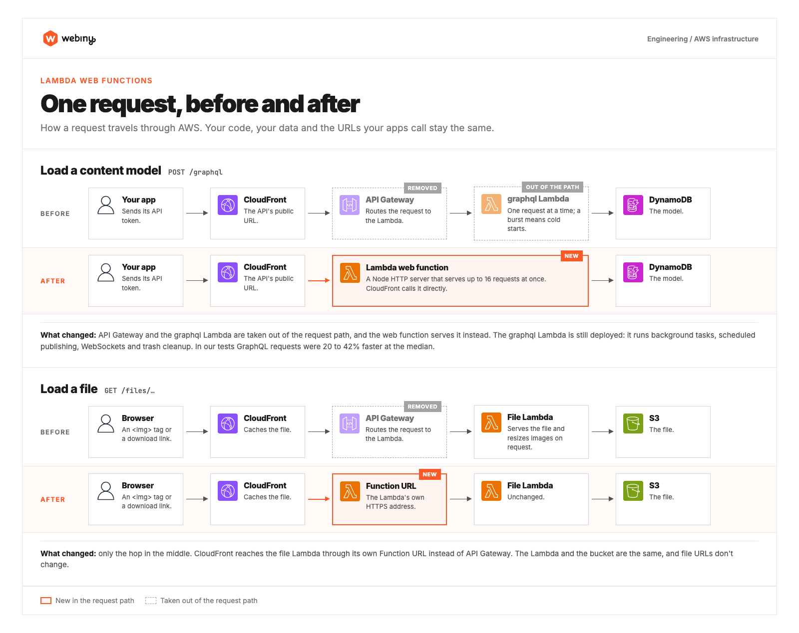
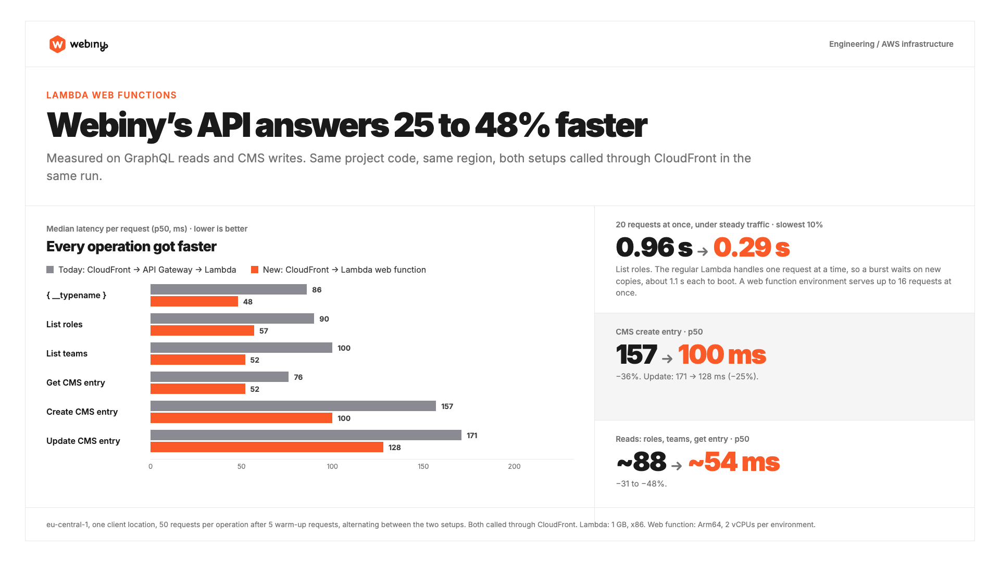
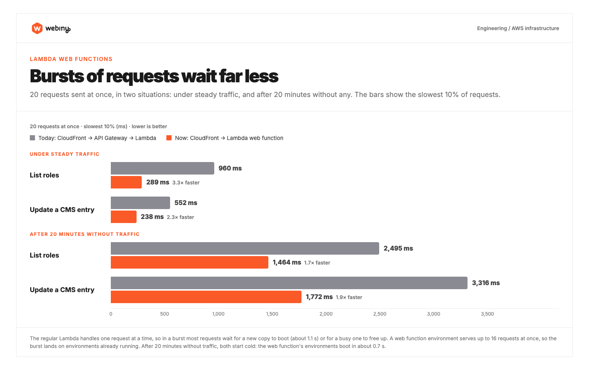

In October, AWS released [Lambda web functions](https://docs.aws.amazon.com/lambda/latest/dg/web-functions.html), a new kind of Lambda that runs your code as an ordinary Node HTTP server. We spent last week moving Webiny's API onto them, and the short version is that the API got a lot faster. GraphQL requests answer 25 to 48% faster at the median, and when many requests arrive at once, they wait far less.

The change is in review now and will most likely ship in Webiny 6.6. This post is about what changes and the numbers we measured. How to switch a project you already have will come in a separate post, once it's ready for you to try.

## How the API runs today

Every request to a Webiny API on AWS takes the same path. CloudFront receives it, hands it to API Gateway, and API Gateway invokes the API's Lambda function.

That setup has served us well for years, but it has two costs. API Gateway is one more hop on every request. It's a good service if you need what it adds, like throttling, usage plans or request validation, but Webiny's API used none of that. API Gateway only passed requests on to the Lambda. And a regular Lambda function handles one request at a time. When ten requests arrive at once and only three copies of the function are warm, Lambda starts seven new copies, and each of those requests waits for its copy to boot. For Webiny's API that boot took about 1.1 seconds in our tests, before the request itself even started.

Here's one request on that path, and the same request on a web function:

## What a web function changes

A web function is a Node HTTP server that Lambda runs and scales for you. One running copy, which AWS calls an environment, serves many requests at the same time, the way any web server does. We let each environment take up to 16 at once.

CloudFront calls the web function directly, and there's no API Gateway in between. `/graphql`, the Headless CMS APIs, the Website Builder routes and any custom routes you've added with `<Api.Route>` all go there. File requests lose API Gateway too. CloudFront now calls the file Lambda through its own Function URL, and the Lambda itself is unchanged.

Some things don't change. Web functions only answer HTTP requests. So background tasks, scheduled publishing, the WebSocket API and the nightly trash cleanup still run on regular Lambda functions, exactly as before. They run the same code as the web function, so nothing behaves differently.

## Why this needed 6.6

6.6 isn't out yet. It's still in the works, but without it we couldn't have done this at all, because the backend didn't have the architecture for it (that's a topic for another post). Since the summer we've been building 6.6 in parallel with 6.5, and a big part of that work went into how the backend code is structured. That restructuring is what lets the same API code run on a web function, so for us the switch was mostly an infrastructure change and not a rewrite of the API. It's also the work behind [standalone Webiny](https://www.webiny.com/blog/webiny-is-no-longer-aws-only-introducing-standalone-webiny), which runs the API as a plain Node process.

## The numbers

We deployed the same project twice in eu-central-1, once with each setup. We called both through CloudFront, the way your users reach them, from the same machine in the same run. Each operation got 50 requests after 5 warm-up requests, alternating between the two setups.

| Median per request | API Gateway + Lambda | Web function |
|---|---|---|
| `{ __typename }` | 86 ms | 48 ms |
| List roles | 90 ms | 57 ms |
| List teams | 100 ms | 52 ms |
| Get a CMS entry | 76 ms | 52 ms |
| Create a CMS entry | 157 ms | 100 ms |
| Update a CMS entry | 171 ms | 128 ms |

Reads were 31 to 48% faster and writes 25 to 36%. Across our test runs the exact numbers moved by a few tens of milliseconds for both setups, because network conditions differ from run to run. The web function was faster in every run.

The bigger difference shows up when requests arrive together. We sent 20 requests at once in two situations. In the first, each setup had been serving one request a second for a minute before the burst, and we did that three times. In the second, nothing had reached either setup for 20 minutes, and we did that twice for each operation.

| 20 requests at once, slowest 10% | API Gateway + Lambda | Web function |
|---|---|---|
| List roles, under steady traffic | 960 ms | 289 ms |
| Update a CMS entry, under steady traffic | 552 ms | 238 ms |
| List roles, after 20 idle minutes | 2,495 ms | 1,464 ms |
| Update a CMS entry, after 20 idle minutes | 3,316 ms | 1,772 ms |

In the steady traffic test, the old setup was slow because of the cold starts described earlier. One request a second keeps few copies of the regular Lambda warm, so most of a burst waits for a new copy to boot or for a busy one to free up. A web function environment takes up to 16 requests at once, so the burst lands on environments that are already running.

After 20 idle minutes, both setups start from nothing, and the web function has a cold start too. In our tests its environments shut down about six minutes after the last request, and a new one took about 0.7 seconds to boot. Every request in the burst waited for that, so all 20 took over a second. The old setup still took 1.7 to 1.9 times as long, because each of its requests waited for a copy of its own.

## Where the speed comes from

Three things, and we can't give you an exact split between them.

**No API Gateway.** One less service between CloudFront and your code on every request.

**Fewer cold starts.** One environment serves up to 16 requests at once, so Lambda starts far fewer of them.

**More CPU, on ARM.** Every web function environment gets 2 vCPUs on AWS Graviton, ARM processors. The API's regular Lambda function runs with 1 GB of memory, and Lambda hands out CPU in proportion to memory, so it gets a fraction of one vCPU.

You don't configure that last one. Web functions only run on ARM, so every Webiny project gets Graviton without changing anything.

## What we haven't measured yet

**Cost.** Web functions are billed differently from regular Lambda functions. You pay for requests, for the CPU time your code actually uses, and for memory for as long as an environment is running. Whether that comes out cheaper or more expensive depends on your traffic, and we haven't compared bills yet.

**Other regions and other locations.** Every number above is from eu-central-1, measured from one location.

**Large requests.** Our tests were GraphQL reads and CMS writes, not big exports or imports.

We'll share more as real projects start running on this.

## Wrapping up

Every request we measured got faster, bursts of traffic wait far less, and none of it changes how you write code for Webiny. Your GraphQL schema, plugins, custom routes and extensions run exactly as they do today.

This isn't released yet. We expect it to be part of 6.6, possibly as early as the first 6.6 beta. We'll post updates as it gets closer. When you can try it, a second post will cover how to switch your project. After that, we'd like to hear what you see, especially if your numbers don't look like ours.
